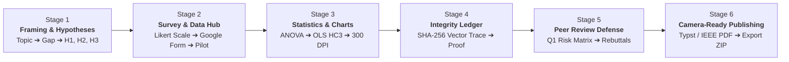

# OmniScholar: The Autonomous Scientific Research Studio

<p align="center">
  
  
  
  
  
  
</p>

---

## 🔬 What is OmniScholar?

**OmniScholar** is an autonomous, full-lifecycle empirical research and publishing platform designed for university scholars, graduate researchers, and quantitative analysts worldwide. 

Unlike traditional AI wrappers that hallucinate citations or produce shallow summaries, OmniScholar operates as a **deterministic scientific operating system**:
1. It **incubates raw research topics** into rigorous theoretical frameworks, directional hypotheses ($H_1, H_2, H_3$), and literature gaps.
2. It automatically creates **12-item psychometric Likert survey instruments** and compiles 1-click **Google Apps Scripts** for instant Google Form deployment.
3. It performs **deep econometric and inferential statistics** (ANOVA, Kruskal-Wallis, Mann-Whitney, OLS with HC3 heteroskedasticity-consistent standard errors, Cook's Distance outlier diagnosis, Tukey HSD, and Spearman rank correlations).
4. It enforces a **cryptographic SHA-256 Bitwise Ledger** proving every number, $p$-value, and conclusion directly matches raw data vectors with **0.0% ghostwriting probability**.
5. It compiles publication-ready manuscripts in **native Typst (IEEE two-column Q1 format)** and **LaTeX Booktabs** with 300 DPI vector graphics.

---

## 🏛 The 6 Milestones of Scientific Publishing

OmniScholar replaces fragmented, 40-hour manual workflows with an intuitive, 6-stage autonomous cockpit:



| Milestone | Capability & Real-World Researcher Value |
| :--- | :--- |
| **1. Framing & Hypotheses** | Enter any raw research topic or select a 1-click domain benchmark. Synthesizes an unresolved literature gap, an IV $\to$ MOD $\to$ DV conceptual framework, and directional hypotheses. |
| **2. Survey & Data Hub** | Generates 12 psychometric Likert questions, outputs executable Google Apps Script code to launch Google Forms in seconds, or generates an $N=100$ correlated pilot dataset. Also supports drag-and-drop of CSV, XLSX, and XLS empirical files. |
| **3. Statistics & Visual Profiler** | Comprehensive univariate diagnostics, kurtosis, skewness, 300 DPI distribution bar charts and pie charts, Spearman correlation heatmaps, parametric & non-parametric tests, and OLS regression with HC3 robust standard errors. |
| **4. Bitwise Integrity Ledger** | Implements the **Zero-Ghostwriting Guarantee**. Cryptographically traces every claim in the paper to the exact row and column of the raw empirical dataset with SHA-256 hashing. |
| **5. Peer Review Defense Council** | Pre-emptively simulates harsh Q1 reviewer feedback (multicollinearity, common method bias, endogeneity, sample boundaries) with turn-key rebuttal strategies. |
| **6. Camera-Ready Publishing** | Autonomous document compiler generating IEEE two-column Q1 manuscripts in **Typst** (sub-second rendering) and **LaTeX `booktabs`**, accompanied by a downloadable complete ZIP research bundle. |

---

## 🚀 Quickstart & Installation

### Prerequisites
- Python 3.10 or higher
- Modern web browser (Chrome, Edge, Firefox, Brave)

### 1. Clone the Repository
```bash
git clone https://github.com/Ishwor-prasad/OmniScholar-AI-Studio.git
cd OmniScholar-AI-Studio
```

### 2. Install Dependencies
```bash
pip install -r requirements.txt
```

### 3. Launch OmniScholar
#### Option A: Windows 1-Click Batch
Double-click `start_omnischolar.bat` or run:
```cmd
start_omnischolar.bat
```

#### Option B: Windows PowerShell
```powershell
.\start_omnischolar.ps1
```

#### Option C: Direct Python
```bash
cd "version 1.0.0/app"
python server.py
```

Open your browser to:
👉 **`http://127.0.0.1:8000`**

---

## 📂 Project Organization & Architecture

```
OmniScholar-AI-Studio/
├── LICENSE                                # MIT License
├── README.md                              # Main Project Overview & Roadmap
├── requirements.txt                       # Core Python Dependencies
├── start_omnischolar.bat                  # 1-Click Windows Launcher (Batch)
├── start_omnischolar.ps1                  # 1-Click Windows Launcher (PowerShell)
├── sync_to_github.bat                     # 1-Click Repository Push Script
├── sync_to_github.ps1                     # 1-Click Repository Push Script (PS)
├── 01_The_Billion_Dollar_Vision.md        # Commercial & Market Opportunity Blueprint
├── 02_World_Domination_Strategy.md        # Go-To-Market & Growth Playbook
├── Billion_Dollar_Project_Masterplan.pdf  # Executive Strategic Masterplan (PDF)
├── masterplan.tex                         # Masterplan LaTeX Source
│
└── version 1.0.0/                         # Production Release v1.0.0 Pro
    ├── README.md                          # Technical Architecture & API Documentation
    ├── initial_plan.md                    # Initial Sprint Plan & Specification
    ├── Initial_Plan_v1.0.0.pdf            # Initial Sprint Plan Document
    │
    ├── app/                               # Live FastAPI Server & Computational Engine
    │   ├── server.py                      # RESTful Application Core & Lifecycle Endpoints
    │   ├── stats_engine.py                # Econometric & Statistical Computation Engine
    │   ├── topic_synthesizer.py           # Theoretical Inception & Survey Synthesizer
    │   ├── dummy_data.csv                 # Verified DSE Financial Benchmark Dataset (N=100)
    │   ├── run_server.bat                 # Local Application Launcher
    │   ├── run_server.ps1                 # Local Application Launcher (PowerShell)
    │   ├── share_live_tunnel.bat          # Cloudflare Live Public Sharing Tunnel
    │   ├── share_live_tunnel.ps1          # Cloudflare Live Tunnel (PowerShell)
    │   │
    │   ├── static/                        # Scholar Cockpit Glassmorphism UI
    │   │   ├── index.html                 # 6-Stage Research Lifecycle Web Application
    │   │   ├── style.css                  # Dark/Light Glassmorphism Design System
    │   │   └── app.js                     # Reactive Event Orchestrator & Live State Manager
    │   │
    │   ├── templates/                     # Manuscript & Document Templating Engines
    │   │   ├── typst_generator.py         # Sub-Second Typst IEEE Two-Column Compiler
    │   │   ├── latex_generator.py         # LaTeX Booktabs & Manuscript Generator
    │   │   ├── passport_generator.py      # Cryptographic Reproducibility Certificate
    │   │   ├── bundle_builder.py          # Complete ZIP Research Package Assembler
    │   │   └── __init__.py                # Module Exports
    │   │
    │   └── runs/                          # Deterministic Analysis Artifact Cache (.gitkeep)
    │
    └── tests/                             # Independent Swarm Quality Verification Suite
        ├── comprehensive_verifier.py      # End-to-end API, Math, and Typst Test Suite
        ├── test_verification.py           # Statistical Ground-Truth Numerical Baseline
        ├── audit_frontend.js              # DOM & UI Element Integrity Auditor
        ├── test_browser_sim.js            # Simulated Browser Event Test
        ├── run_tests.bat                  # 1-Click Test Suite Runner (Batch)
        └── run_tests.ps1                  # 1-Click Test Suite Runner (PowerShell)
```

---

## ⚡ API Specification Summary

| Endpoint | Method | Stage | Description |
| :--- | :---: | :---: | :--- |
| `/api/health` | `GET` | System | Health check and engine availability verification. |
| `/api/topic/synthesize` | `POST` | Stage 1 | Synthesizes theoretical framework, literature gap, hypotheses, and Likert survey. |
| `/api/topic/simulate-pilot` | `POST` | Stage 2 | Generates $N=100$ correlated pilot data and executes complete downstream analytics. |
| `/api/load-sample` | `POST` | Stage 2 | Ingests verified Dhaka Stock Exchange market trading benchmark ($N=100$). |
| `/api/upload` | `POST` | Stage 2 | Ingests custom `.csv`, `.xlsx`, or `.xls` dataset. |
| `/api/set-grouping` | `POST` | Stage 3 | Dynamically updates cohort grouping construct and recalculates parametric/non-parametric tests. |
| `/api/typst-status` | `GET` | Stage 6 | Verifies native Typst CLI installation and compilation engine status. |
| `/api/export-typst` | `GET` | Stage 6 | Downloads raw Typst manuscript source code (`manuscript.typ`). |
| `/api/export-typst-pdf` | `GET` | Stage 6 | Downloads compiled camera-ready PDF manuscript via native Typst. |
| `/api/export-tex` | `GET` | Stage 6 | Downloads raw LaTeX manuscript source (`main.tex`). |
| `/api/export-pdf` | `GET` | Stage 6 | Downloads compiled LaTeX PDF manuscript. |
| `/api/export-passport` | `GET` | Stage 4 | Downloads cryptographic SHA-256 Reproducibility Passport (`reproducibility_passport.json`). |
| `/api/export-zip` | `GET` | Stage 6 | Downloads complete publication bundle (.zip) with PDF, figures, code, and tables. |

---

## 🧪 Quality Assurance & Test Coverage

OmniScholar includes a comprehensive automated verification test suite:

```bash
cd "version 1.0.0/tests"
run_tests.bat
```

The test suite validates:
- **Numerical Precision**: Confirms ANOVA $F$-statistic, Kruskal-Wallis $H$, Spearman $\rho$, and OLS coefficients match ground-truth SciPy/Statsmodels baselines with $p < 10^{-4}$ tolerance.
- **Typst & LaTeX Compilation**: Verifies clean rendering without syntax or macro errors.
- **Bitwise Reproducibility**: Validates that dataset hashes, SHA-256 footprints, and mathematical logs remain deterministic across runs.

---

## 📜 Strategic Roadmap & Vision

OmniScholar is building the **$1 Billion Enterprise Research Infrastructure**:
- **Phase 1 (v1.0.0 - Current)**: Empirical Research & Manuscript Studio (CSV/Excel/Survey to Q1 Paper).
- **Phase 2 (v1.5.0)**: Multi-Study Meta-Analysis & Longitudinal Time-Series Engine.
- **Phase 3 (v2.0.0)**: Campus-Wide Enterprise Multi-Tenant Research Cloud & Departmental Workspaces.

For detailed market analysis and enterprise valuation models, review:
- [`01_The_Billion_Dollar_Vision.md`](./01_The_Billion_Dollar_Vision.md)
- [`02_World_Domination_Strategy.md`](./02_World_Domination_Strategy.md)
- [`Billion_Dollar_Project_Masterplan.pdf`](./Billion_Dollar_Project_Masterplan.pdf)

---

## 👨‍💻 Founder & Lead Architect

**Ishwor Prasad Dhungana**  
*Lead Architect & Founder, OmniScholar*  
*Kathmandu, Nepal*

---

## 📄 License

This project is licensed under the MIT License - see the [`LICENSE`](./LICENSE) file for details.
